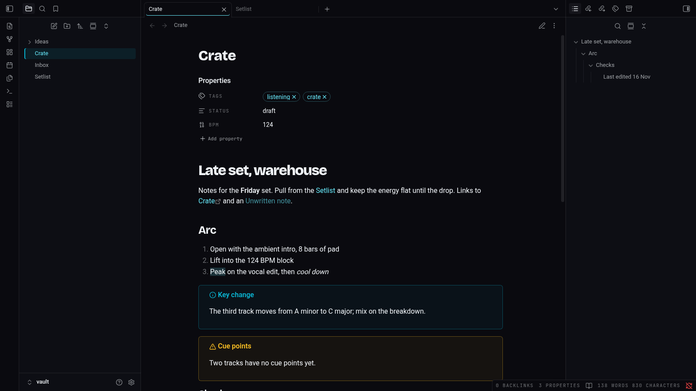

# Crate

An Obsidian theme in the look of [Crate](https://cratemusic.app): a near-black
canvas, hairlines instead of filled boxes, one cyan accent and 6 px corners.
Titles are set in Bricolage Grotesque, labels (property names, table headers,
the status bar, settings sections, `######` headings) in JetBrains Mono caps,
and everything else in Roboto. The three fonts are embedded, so the theme
works offline and loads nothing from the network.



## Modes

Crate is a dark theme. In light mode Obsidian keeps its own light colours and
Crate brings only its type, corners and a darker cyan accent.

## Install

Settings > Appearance > Themes > Manage, search for **Crate**, then Install and
use. On a [Ryoku](https://github.com/Ryoku-dev/ryoku) desktop,
[Crate for Ryoku](https://github.com/thecrateapp/crate-for-ryoku) copies it into
every vault for you.

## Snippets

Every colour is an Obsidian variable, so a snippet can change any of them. The
theme's own values live in `--crate-*` variables under `.theme-dark`, for
example:

```css
.theme-dark {
  --crate-accent: #22d3ee;
}
```

## Licence

MIT (LICENSE). The embedded fonts are under the SIL Open Font License 1.1:
Bricolage Grotesque, Roboto and JetBrains Mono, each by its project's authors.
The theme is built from
[crate-for-ryoku](https://github.com/thecrateapp/crate-for-ryoku)
(`apps/obsidian`); changes go there first.
