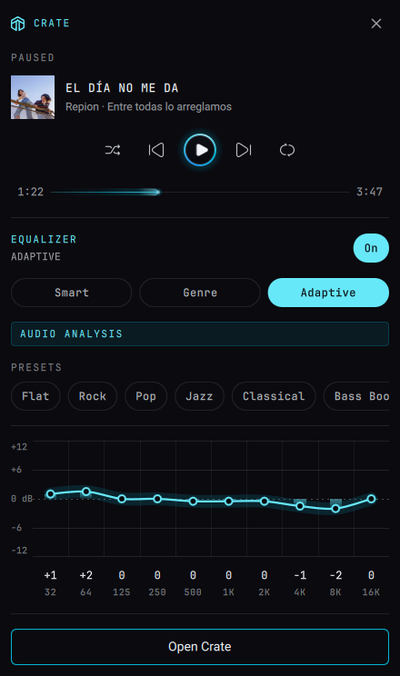

# Crate mark (`crate-mark`)

The Crate logo on the QS Bar, part of the Crate for Ryoku. While Crate plays,
three cyan bars follow the mark, then the artist and track title. Long titles
scroll continuously within the bar at 50 logical pixels per second at normal scale.
Pausing leaves the current track visible and still. A click opens a panel drawn to Crate's
own player spec (1 px glow beams, the spectrum play button, chips, the EQ chart): now
playing, transport and Crate's equalizer. Roboto ships in `content/fonts` (OFL).



## Only when Crate is installed

The mark collapses to nothing when no Crate desktop entry is installed. A Ryoku bar
plugin cannot drop its own slot (the host keeps a few pixels for every loaded plugin),
so Crate for Ryoku also hides the slot itself with `ryoku-shell bar hide crate-mark`,
and shows it again when Crate is installed (`crate-presence.sh`, run on install and
by the rice's `crate-icons-auto` watcher whenever apps change). It acts only when
Crate appears or disappears, so a mark you hid yourself stays hidden.

## The panel

- **Now playing:** cover, the title as an all-caps JetBrains Mono ticker (it scrolls
  only while Crate plays and the title is too long: 2 s pause, 20 ms per pixel, 0.9 s
  pause), artist and album, progress (click to seek), and
  shuffle / previous / play-pause / next / repeat.
- **Equalizer:** on/off; the mode, as in Crate's player: Smart (the server's curve for
  the track, with its source: your preset, a curator preset, the genre taxonomy, audio
  analysis), Genre (the track's genre preset), Adaptive (from audio analysis features),
  or Manual; the preset in Manual (‹ ›); and the 10-band curve, editable in Manual.
- **Open Crate:** brings the running app forward, or starts it.

## What it runs, reads and writes

- **Runs:** one `bin/read-position` helper (Python 3 and PyGObject) while the track panel is open. "Open Crate" starts the desktop entry named by
  `appId` (or the packaged `Crate` entry) through Quickshell's `DesktopEntries`, only
  on that click.
- **Reads:** its own settings; the desktop-entry database; the Crate player on MPRIS
  (`org.mpris.MediaPlayer2.crate`) for now playing and transport; and Crate's local
  control socket, `$XDG_RUNTIME_DIR/crate/control.sock` (Crate 3.4+, owner-only),
  for shuffle, repeat and the equalizer. It connects only while Crate's
  player is on the bus. The helper reads the raw MPRIS position once per second during playback and on track, pause or seek changes.
- **Controls:** every change is a click or drag and goes to Crate: transport over
  MPRIS, the rest as one JSON line on the socket (`{"cmd":"eq_mode","mode":"genre"}`).
  With an older Crate (no socket) the panel shows now playing and transport only.
  There is no volume slider: Crate's player volume is not the system volume yet, so
  the bar's own audio panel stays the place for volume.
- **Network:** none. **Writes:** nothing. No privileged commands.

## Settings (QS Bar Settings > Community > Crate)

| key        | type   | default                        | what it does |
| ---------- | ------ | ------------------------------ | ------------ |
| tone       | choice | `accent`                       | `accent` follows the theme, `brand` is Crate's own gradient, `ink` is the bar text colour |
| showLabel  | toggle | `false`                        | show a lowercase "crate" label after the mark |
| nowPlaying | choice | `track`                        | `track`: playing bars and an artist/title ticker; `indicator`: playing bars only; `off`: panel only |
| appId      | text   | `app.cratemusic.crate.desktop` | the desktop entry "Open Crate" starts |

## Credits

Icons are Solar (Solar Icons Set by 480 Design, CC BY 4.0), the set Crate's UI uses,
with the weights Crate's player uses: `skip-previous`, `skip-next`, `shuffle`,
`repeat` and `repeat-one` Outline; `play` and `pause` Bold. The mark is the Crate logo
outline (`app/web/public/icons/logo.svg` in the Crate repository) as a vector `Shape`.

## Build, check, install

```
ryoku plugin validate .
ryoku plugin add . --bar --yes
ryoku-shell bar move crate-mark --section left --after launcher
```

Crate for Ryoku carries this placement and the settings above (`look.plugins` and
`qsbar.layout` in `rice.json`).

## Author

Diego <yosoy@diego.ninja>. Community-made (`official` is false).
